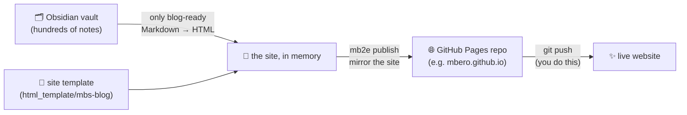
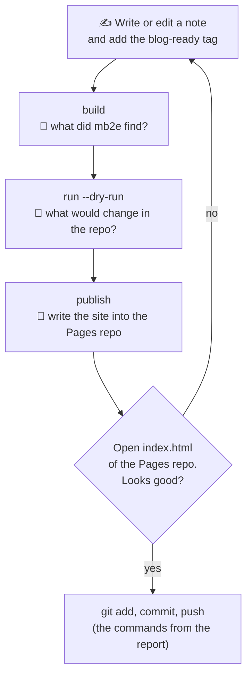
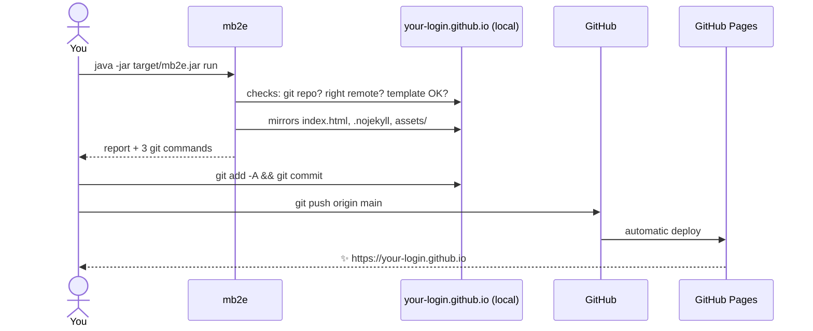

# mb2e
Markdown based blog engine
<br>


## What's this?

You write notes in Obsidian. Some of them deserve an audience. **mb2e** picks those notes out of your vault and turns them into a simple static website hosted on GitHub Pages. You don't need a server, a database or a CMS.

It works in three steps:

1. **You keep notes in Obsidian.** Tag the ones you want to publish with `blog-ready` in the front matter.
2. **Your vault's structure becomes the site's content.** Folders turn into categories, notes into articles, and `[[wikilinks]]` into real links.
3. **The output is GitHub Pages-ready.** mb2e takes your site template, adds one generated file, `assets/js/data.js`, and writes the result into your local GitHub Pages repo.

Nothing is kept in between. Every run reads the vault and the template, builds the site in memory and (for `publish`) writes it into the Pages repo. That's it: three folders, no copies.



`mb2e build` only looks and reports. `mb2e publish` also writes into the Pages repo. `mb2e run` does both in one report.

## Tagging a note for publication

All you need is a tag in the front matter. The tag is `blog-ready` by default; pick your own with `mb2e.tag` (see [Configure](#configure)). Every spelling Obsidian understands works:

```markdown
---
title: Java Collections – cheat sheet
tags:
  - java
  - blog-ready
---

Your note…
```

`tags: [java, blog-ready]` and `tags: java, blog-ready` work too. Case doesn't matter.

What ends up where:

| In the vault | On the site |
|---|---|
| folder `Java/Collections/` | a folder `Java/Collections` in the left panel |
| front matter `title` (or the file name) | article title |
| the note's text | one block of HTML on the page |
| `[[Another note]]` | a link to that note, if it is published too |
| `![[image.png]]` | the image, copied to `assets/img/notes/` |

If a note repeats its own title as the first `# Heading`, mb2e drops that heading, because the page already shows the title.

## The About page

The site has an About page, and it comes from a note. This is all you do:

1. Create a note called `about.md` at the **root** of your vault, not inside a folder.
2. Tag it like any other note, with `tags: [blog-ready]` in the front matter.
3. Write whatever you want people to read about you.

That's it. The page shows up behind the link at the bottom of the left panel. It is **not** in the tree of notes. By default it is also the start page of the site (the setting `mb2e.default-note`, which is `about`).

If `about.md` is missing, or has no tag, the build warns you and the site simply has no About page. A file called `about.md` inside a folder is an ordinary note, not the About page.

## What you need

- **Java 25** and **Maven 3.9+**.
- An Obsidian vault on disk.
- **A site template**: a folder in the format of `html_template/mbs-blog`. It needs `index.html` and `assets/js/app.js`, and that `app.js` must know how to show an `html` block (its text contains `case 'html'`). mb2e only reads the template and never changes it.
- **A local clone of your GitHub Pages repo**, e.g. `your-login.github.io`.

## Install

```bash
git clone https://github.com/mbero/mb2e.git
cd mb2e
mvn -q clean verify          # tests + build
ls target/mb2e.jar           # done
```

### Make `mb2e` a real command (macOS)

Typing `java -jar target/mb2e.jar run` gets old fast. macOS uses zsh by default, so add a small shell function and type `mb2e run` from anywhere instead. Run this **from the mb2e directory** (the one with `application_local_paths.yaml`):

```bash
grep -qs '^mb2e()' ~/.zshrc || echo "mb2e() { (cd \"$PWD\" && java -jar target/mb2e.jar \"\$@\") }" >> ~/.zshrc
source ~/.zshrc
type mb2e                    # → mb2e is a shell function
```

Then, from any folder:

```bash
mb2e run --dry-run           # preview
mb2e run                     # the real thing
mb2e                         # interactive shell
```

A few notes:

- It's a **function, not an alias**, because zsh aliases can't take arguments (`alias mb2e='… "$@"'` ends in `parse error near 'run'`).
- The function `cd`s into the mb2e directory in a subshell, so mb2e finds `application_local_paths.yaml`, and your own terminal stays where it was.
- The `grep -qs` guard makes the line safe to paste twice: it's only added once.
- Moved the repo? Delete the `mb2e() { … }` line from `~/.zshrc` and run the snippet again from the new place.
- On bash instead of zsh, use `~/.bash_profile` in place of `~/.zshrc`.

## Configure

You need three paths. They are machine-specific, so they live in **`application_local_paths.yaml`**. This file is git-ignored, so your real paths never land in the repo. Start from the template:

```bash
cp application_local_paths.example.yaml application_local_paths.yaml
# then fill in your paths
```

mb2e reads that file from the working directory, so run it from the repo root. To keep the file somewhere else, point `MB2E_CONFIG` at it:

```bash
export MB2E_CONFIG=~/.config/mb2e/application_local_paths.yaml
```

The three paths, and nothing else you must set:

```yaml
mb2e:
  vault:
    path: "/path/to/vault"                  # your Obsidian vault (mb2e only reads it)
  template:
    path: "/path/to/html_template/mbs-blog" # the site template (mb2e only reads it)
  target:
    path: "/path/to/your-login.github.io"   # the local Pages repo (the only place mb2e writes)
```

`build` needs only the vault and the template. `publish` and `run` need all three. If a path isn't set, the command refuses and tells you which key is missing, for example `mb2e.target.path`.

There are a few optional settings. Here they are with their defaults:

```yaml
mb2e:
  tag: blog-ready        # the tag that selects a note
  inline-tags: false     # true = a #blog-ready in the body counts too
  default-note: about    # the note the site opens on (empty = the first note)
  force: false           # true = a Pages remote that looks wrong is only a warning
  log:
    file: ""             # optional log file; empty = no file
```

mb2e prints one line per step (build, publish) with the outcome, the counts and the trace id on stderr, so stdout stays clean for `--json`. Set `mb2e.log.file` and the same lines also go to that file, together with the full stack trace of anything that blows up.

Changes to `application_local_paths.yaml` take effect on the next run, with no rebuild needed. Settings are layered: the packaged `application.yaml` comes first, then `application_local_paths.yaml`, then `SPRING_APPLICATION_JSON`, and each layer overrides the one before it. To override a single setting for one run:

```bash
export SPRING_APPLICATION_JSON='{"mb2e.tag":"draft-ready"}'
```

Command-line arguments **never** change the configuration. `--mb2e.vault.path=...` simply gets refused.

## Commands

| Command | What it does |
|---|---|
| `build` | Selects the tagged notes, renders them and assembles the site **in memory**. It writes nothing, anywhere, and tells you what it found. |
| `publish` | Does the same build, then mirrors the site into the Pages repo. It prints the git commands at the end but never runs them. |
| `run` | `build` → `publish`, with one report that has a `build` and a `publish` section. It stops at the first refusal. |
| `usage`, `help` | Cheat sheets. |

Every working command accepts two flags:

- `--dry-run` shows what would happen and writes nothing.
- `--json` prints one JSON object on stdout, which is handy for scripts.

`run` also takes `--no-publish`, which makes it do the same as `build`.

Exit codes: **0** means success, **1** means refused. The refusal message tells you exactly what's wrong, for example which folder is missing.

Run it with no arguments to get an interactive shell with the logo. Type `exit` to leave.

## What lands in the Pages repo

`publish` makes the Pages repo hold exactly this site:

- `index.html` from the template,
- everything under the template's `assets/` (except its own sample `assets/js/data.js`, any `.md` file and `.DS_Store`),
- the generated `assets/js/data.js`, which holds the whole content as `window.BLOG_DATA = { defaultNote, TREE, NOTES }`,
- the images your published notes embed, under `assets/img/notes/<path in the vault>`,
- an empty `.nojekyll`, so GitHub doesn't run the site through Jekyll.

Everything else in the repo (`README.md`, `CNAME`, `.github/`) is left alone. Because the whole content sits in one JavaScript file, the site also works when you open `index.html` straight from disk.

The template's folder `assets/img/notes/` belongs to mb2e, so a template that has files there is refused.

## Bring your own template

`mb2e.template.path` can point at **any** folder that follows a small contract. The one shipped with mb2e lives in [`src/main/resources/template/mbs-blog`](src/main/resources/template/mbs-blog). Copy it and restyle it, or build your own from scratch.

### Folder layout

```
my-template/
├── index.html              REQUIRED  the one page of the site
└── assets/
    ├── js/
    │   ├── app.js          REQUIRED  renders the page from window.BLOG_DATA
    │   └── data.js         optional  sample data for local design work; never published
    ├── css/…               optional  anything you like
    └── img/…               optional  anything you like, EXCEPT img/notes/
```

| Rule | What happens if you break it |
|---|---|
| `index.html` exists at the template root | `build` refuses: *index.html is missing* |
| `assets/js/app.js` exists | `build` refuses: *assets/js/app.js is missing* |
| `app.js` contains the text `case 'html'` (it renders html blocks, see below) | `build` refuses: *not a site template* |
| `assets/img/notes/` is empty or absent | `build` refuses: that folder belongs to mb2e, it writes the note images there |

### What gets published, and what doesn't

- **Published:** `index.html` and every file under `assets/`.
- **Not published:** anything else at the template root (a `README.md`, a second `.html` page, `favicon.ico`…). Put extra files under `assets/`.
- **Never published:** any `.md` file, `.DS_Store`, and the template's own `assets/js/data.js` (mb2e writes a generated one in its place).
- **Mirrored:** the Pages repo's `assets/` ends up holding exactly the template's `assets/` plus the generated files. A file you delete from the template's `assets/` is deleted from the Pages repo on the next `publish`.

### Wiring in `index.html`

Load the data before the app, with relative paths (the site must also work from `file://`):

```html
<script src="assets/js/data.js"></script>
<script src="assets/js/app.js"></script>
```

### The data your `app.js` gets

mb2e writes `assets/js/data.js` as one global object:

```js
window.BLOG_DATA = {
  defaultNote: "about",                 // the note to open when the URL has no #/…
  TREE: [                               // the vault folders, in display order
    { name: "Java", children: [
      { name: "Collections", children: [
        { note: "Java/Collections/Cheatsheet" }      // a leaf = a note id
      ] }
    ] }
  ],
  NOTES: {
    "Java/Collections/Cheatsheet": {
      title: "Collections Framework — cheatsheet",   // front matter title, else the file name
      category: "Java/Collections",                  // the note's folder in the vault
      date: "2026-11-06",                            // front matter date, else ""
      tags: ["java", "blog-ready"],                  // front matter tags
      blocks: [ { type: "html", html: "<h2>…</h2><p>…</p>" } ]
    },
    "about": { /* about.md: in NOTES, never in TREE */ }
  }
};
```

What your `app.js` has to handle:

- **Exactly one block per note**, `{ type: "html", html: "…" }`, holding the whole note already rendered to HTML. Insert it as HTML (for example `div.innerHTML = block.html`). That `case 'html'` is also the marker mb2e checks for.
- **Note ids are vault paths without `.md`**, with `/` between folders. Links between notes arrive as `<a href="#/Java/Collections/Cheatsheet">` (each path segment URL-encoded), so route on `location.hash`.
- **The About page** is `NOTES.about` and is not in `TREE`; link to it yourself (mbs-blog uses `#/about` at the bottom of the sidebar). It can be missing, so guard against `NOTES.about === undefined`.
- **`defaultNote`** always names a published note: mb2e checks `mb2e.default-note` and falls back to the first note of `TREE` (with a warning) if that note isn't published. Use it when the URL has no `#/…`, or names an unknown note.

### HTML inside a note, for your CSS

The rendered notes use plain tags (`h1`–`h6`, `p`, `ul`/`ol`, `blockquote`, `pre > code`, `table`, `img`, `a`) plus a few classes worth styling:

| Markup | Meaning |
|---|---|
| `<code class="language-java">` | a fenced code block with a language |
| `<div class="table-wrap"><table>…` | a table, wrapped so it can scroll sideways |
| `<span class="missing-link" title="…">` | a link to a note that isn't published, or to a missing attachment |
| `` | an image from the vault, copied next to the site |

The mbs-blog stylesheet styles all of them under `.prose`, a good starting point.

## Working locally, step by step



1. **See what mb2e finds:**
   ```bash
   java -jar target/mb2e.jar build
   ```
   The report shows how many notes were picked, the images, the links that point to untagged notes, and warnings such as a missing About page.
2. **Plan the publication:**
   ```bash
   java -jar target/mb2e.jar run --dry-run
   ```
3. **Publish into your local Pages repo:**
   ```bash
   java -jar target/mb2e.jar run
   ```
4. **Preview.** Open `index.html` from the Pages repo, or start a tiny server:
   ```bash
   cd /path/to/your-login.github.io && python3 -m http.server 8000
   # http://localhost:8000
   ```

## Deploying to GitHub Pages

mb2e never runs `git push`. That's on purpose: you get the last word.



**One-time setup:**

1. Create a repo named `your-login.github.io` on GitHub.
2. Clone it locally and put the clone's path in `mb2e.target.path`.
3. On GitHub, open **Settings → Pages → Build and deployment** and set:
   - **Source:** *Deploy from a branch*
   - **Branch:** `main`, folder `/ (root)`

**Every time you publish:**

```bash
java -jar target/mb2e.jar run
git -C /path/to/your-login.github.io diff --stat     # take a look
# then the commands printed at the end of mb2e's report, roughly:
git -C /path/to/your-login.github.io add -A
git -C /path/to/your-login.github.io commit -m "chore(content): refresh Knowledge Hub"
git -C /path/to/your-login.github.io push origin main
```

A minute or two later, the site is live at `https://your-login.github.io`.

## Safety nets

- **The vault and the template are read-only.** mb2e never writes to them, and `build` writes nothing at all.
- **The remote must be a Pages repo of its owner.** The origin of the target must be `https://github.com/<owner>/<owner>.github.io` or `git@github.com:<owner>/<owner>.github.io`, with or without `.git`, for any owner. `force: true` turns a mismatch into a warning.
- **`publish` only deletes in two places of the Pages repo:** files in `assets/` that are not part of the site any more (a file the template dropped, an image no published note embeds), and a leftover top-level folder from an earlier layout of the site. It doesn't touch the rest of the repo.
- **A note that loses its tag leaves the site** at the next publication, together with the images only it used. The site always mirrors what carries the tag today.
- **`publish` never copies a `.md` file**, not even when a note points an image at one.
- **`publish` never writes through a symlink.** If `assets/` or any folder below it is a link, it refuses.
- **A file whose name only differs in case or Unicode form** (`STYLES.CSS` vs `styles.css`) is rewritten from the site, never deleted, because on a Mac they are the same file.
- **Uncommitted changes in the Pages repo** only give a warning. Site files are overwritten, the rest stays.
- **`publish` refuses** when:
  - the target isn't a git repo or has no `origin`,
  - the remote doesn't look like a Pages repo of its owner,
  - the target is the filesystem root, or the vault or the template lies inside the target (or the other way round),
  - the template has no `index.html`, no `assets/js/app.js`, or an `app.js` without `case 'html'`,
  - no note carries the tag.
- **`--dry-run` really writes nothing**, not even folders.

## Under the hood

mb2e uses Spring Boot and Spring Shell with a hexagonal architecture. The domain knows nothing about the filesystem or git: it gets both through ports in `domain.port.out`, and the shell commands call use cases in `domain.port.in`.

```
io.github.mbero.mb2e
├── adapter.in.shell        commands: build, publish, run, usage, help
├── adapter.out.persistence files: vault, template, Pages repo
├── adapter.out.external    the git program (reads only)
├── domain
│   ├── model               notes, reports, the assembled site
│   ├── port.in / port.out  contracts
│   └── service             BuildService, PublishService, PipelineService,
│                           MarkdownRenderer, Selection, RemoteGuard, TemplateCheck
└── infrastructure          configuration (Mb2eProperties, shell)
```
