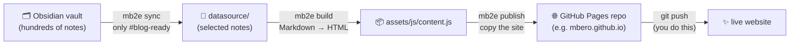
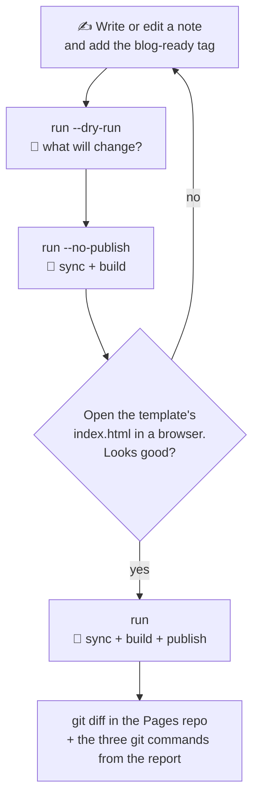

# mb2e
Markdown based blog engine
<br>


## What's this?

You write notes in Obsidian. Some of them deserve an audience. **mb2e** picks those notes out of your vault and turns them into a simple static website hosted on GitHub Pages. You don't need a server, a database or a CMS.

It works in three steps:

1. **You keep notes in Obsidian.** Tag the ones you want to publish with `blog-ready` in the front matter.
2. **Your vault's structure becomes the site's content.** Folders turn into categories, notes into articles, and `[[wikilinks]]` into real links.
3. **The output is GitHub Pages-ready.** You get one `index.html`, a bit of CSS and JS, and a single content file: `assets/js/content.js`.



`mb2e run` does `sync`, `build` and `publish` in one go.

## Tagging a note for publication

All you need is a tag in the front matter. Every spelling Obsidian understands works:

```markdown
---
title: Java Collections – cheat sheet
tags:
  - java
  - blog-ready
---

Your note…
```

`tags: [java, blog-ready]` and `tags: java, blog-ready` work too. Case doesn't matter.

What ends up where:

| In the vault | On the site |
|---|---|
| folder `Java/Collections/` | category `Java/Collections` |
| front matter `title` (or the file name) | article title |
| first paragraph | lead under the title |
| `[[Another note]]` | a link to that note, if it is published too |
| `![[image.png]]` | the image, copied to `assets/media/` |
| text length | reading time (200 words a minute) |

## What you need

- **Java 25** and **Maven 3.9+**.
- An Obsidian vault on disk.
- **A site template**: a folder with `index.html`, `.nojekyll` and `assets/` (CSS, JS). `index.html` must load `assets/js/content.js`.
- **A local clone of your GitHub Pages repo**, e.g. `your-login.github.io`.

## Install

```bash
git clone https://github.com/mbero/mb2e.git
cd mb2e
mvn -q clean verify          # tests + build
ls target/mb2e.jar           # done
```

## Configure

Your paths are machine-specific, so they live in **`application_local_paths.yaml`**. This file is git-ignored, so your real paths never land in the repo. Start from the template:

```bash
cp application_local_paths.example.yaml application_local_paths.yaml
# then fill in your paths
```

mb2e reads that file from the working directory, so run it from the repo root. To keep the file somewhere else, point `MB2E_CONFIG` at it:

```bash
export MB2E_CONFIG=~/.config/mb2e/application_local_paths.yaml
```

If a path isn't set, the command that needs it refuses to run. Everything you can put in the file (all keys are optional except the four paths):

```yaml
mb2e:
  vault:
    path: "/path/to/vault"
  datasource:
    path: "/path/to/template/datasource"   # selected notes land here
  site:
    template-path: "/path/to/template"     # index.html + assets/
  publish:
    target-path: "/path/to/your-login.github.io"
    expected-remote: "your-login.github.io" # safety net: publish checks the remote
  sync:
    tag: blog-ready
    inline-tags: false                      # true = #blog-ready in the body counts too
  build:
    default-note: about                     # the note the site opens on (empty = the first note)
  log:
    file: ""                                # optional log file; empty = no file
```

mb2e always prints one line per step (sync, build, publish) with the outcome, the counts and the trace id on stderr, so stdout stays clean for `--json`. Set `mb2e.log.file` and the same lines also go to that file, together with the full stack trace of anything that blows up.

Changes to `application_local_paths.yaml` take effect on the next run, with no rebuild needed. Settings are layered: the packaged `application.yaml` comes first, then `application_local_paths.yaml`, then `SPRING_APPLICATION_JSON`, and each layer overrides the one before it. To override a single setting for one run:

```bash
export SPRING_APPLICATION_JSON='{"mb2e.sync.tag":"draft-ready"}'
```

Command-line arguments **never** change the configuration. `--mb2e.vault.path=...` simply gets refused.

## Commands

| Command | What it does |
|---|---|
| `sync` | Copies tagged notes (and their attachments) from the vault into `datasource/`. It never deletes anything and never touches the vault. |
| `build` | Renders `datasource/` into `assets/js/content.js`. If something goes wrong, the old file stays. |
| `publish` | Checks the Pages repo, then copies the site into it. It prints the git commands at the end but never runs them. |
| `run` | `sync` → `build` → `publish`. It stops at the first refusal. |
| `usage`, `help` | Cheat sheets. |

Every working command accepts two flags:

- `--dry-run` shows what would happen and writes nothing.
- `--json` prints one JSON object on stdout, which is handy for scripts.

`run` also takes `--skip-sync`, `--skip-build` and `--no-publish`.

Exit codes: **0** means success, **1** means refused. The refusal message tells you exactly what's wrong, for example which folder is missing.

Run it with no arguments to get an interactive shell with the logo. Type `exit` to leave.

## Working locally, step by step



1. **Check the plan:**
   ```bash
   java -jar target/mb2e.jar run --dry-run
   ```
   The report shows how many notes were picked, what gets added or changed, and which links point to untagged notes.
2. **Build without publishing:**
   ```bash
   java -jar target/mb2e.jar run --no-publish
   ```
3. **Preview locally.** Open `index.html` from the template folder, or start a tiny server:
   ```bash
   cd /path/to/template && python3 -m http.server 8000
   # http://localhost:8000
   ```
4. **Publish into your local Pages repo:**
   ```bash
   java -jar target/mb2e.jar run
   ```

## Deploying to GitHub Pages

mb2e never runs `git push`. That's on purpose: you get the last word.


**One-time setup:**

1. Create a repo named `your-login.github.io` on GitHub.
2. Clone it locally and put the clone's path in `mb2e.publish.target-path`.
3. On GitHub, open **Settings → Pages → Build and deployment** and set:
   - **Source:** *Deploy from a branch*
   - **Branch:** `main`, folder `/ (root)`
4. mb2e copies `.nojekyll` for you, so GitHub won't run the site through Jekyll.

**Every time you publish:**

```bash
java -jar target/mb2e.jar run
git -C /path/to/your-login.github.io diff --stat     # take a look
# then the commands printed at the end of mb2e's report, roughly:
git -C /path/to/your-login.github.io add -A
git -C /path/to/your-login.github.io commit -m "chore(content): refresh Knowledge Hub"
git -C /path/to/your-login.github.io push origin main
```

A minute or two later, the site is live at `https://your-login.github.io`.

## Safety nets

- **The vault is read-only.** mb2e never writes to it.
- **`sync` never deletes.** Removing a tag from a note won't delete it from `datasource/`. You clean up by hand.
- **`publish` only deletes in three places of the Pages repo:** files in `assets/` that the template no longer has, media files in `assets/media/` that no published note references anymore, and the old `datasource/` folder. It doesn't touch the rest of the repo.
- **`publish` never copies a `.md` file**, not even when a note points an image at one.
- **`publish` never writes through a symlink.** If `assets/` or any folder below it is a link, it refuses.
- **A file whose name only differs in case or Unicode form** (`STYLES.CSS` vs `styles.css`) is rewritten from the template, never deleted, because on a Mac they are the same file.
- **`publish` refuses** when:
  - the target isn't a git repo,
  - the remote doesn't match,
  - the target is the template folder itself, or one contains the other,
  - the datasource or the template lies inside the Pages repo,
  - the template doesn't load `content.js`,
  - there is no built content.
- **`--dry-run` really writes nothing**, not even folders.

## Under the hood

mb2e uses Spring Boot and Spring Shell with a hexagonal architecture. The domain knows nothing about the filesystem or git: it gets both through ports in `domain.port.out`, and the shell commands call use cases in `domain.port.in`.

```
io.github.mbero.mb2e
├── adapter.in.shell        commands: sync, build, publish, run, usage, help
├── adapter.out.persistence files: vault, datasource, bundle, Pages repo
├── adapter.out.external    the git program (reads only)
├── domain
│   ├── model               notes, reports, bundle
│   ├── port.in / port.out  contracts
│   └── service             SyncService, BuildService, PublishService, PipelineService,
│                           MarkdownRenderer, LinkResolver
└── infrastructure          configuration (Mb2eProperties, shell) and clock
```
